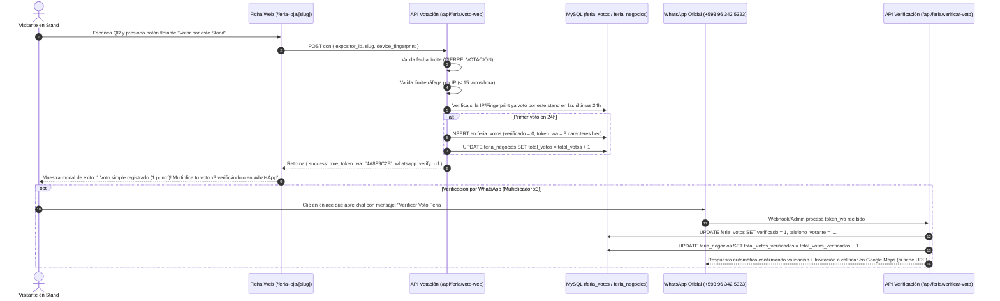

# 🎪 Documentación Técnica y Flujo Operativo: Feria de Loja 197ª

Este documento detalla la arquitectura técnica, base de datos, flujos de usuario, algoritmos de puntuación y medidas de seguridad antifraude implementadas en el sistema de la Feria de Loja dentro de la plataforma **ActivaQR**.

---

## 🧭 1. Arquitectura de Rutas y Páginas

| Ruta Web | Componente Principal | Propósito y Funcionalidad |
| :--- | :--- | :--- |
| `/feria` | [`app/feria/FeriaPageClient.tsx`](file:///d:/Abel%20paginas/Generador%20QR%20contacto/Mayo/Contacto-QR-main/app/feria/FeriaPageClient.tsx) | **Onboarding / Generador de Stand:** Formulario guiado donde el expositor registra su negocio, catálogo y obtiene su QR imprimible. |
| `/feria-loja` | [`app/feria-loja/FeriaHubClient.tsx`](file:///d:/Abel%20paginas/Generador%20QR%20contacto/Mayo/Contacto-QR-main/app/feria-loja/FeriaHubClient.tsx) | **Hub General y Ranking en Vivo:** Directorio con buscador en tiempo real, filtro por categorías (Artesanías, Gastronomía, Café, etc.), Carrusel 3D del Top 5 y clasificación general. |
| `/feria-loja/[slug]` | [`app/feria-loja/[slug]/page.tsx`](file:///d:/Abel%20paginas/Generador%20QR%20contacto/Mayo/Contacto-QR-main/app/feria-loja/%5Bslug%5D/page.tsx) <br> [`FichaClient.tsx`](file:///d:/Abel%20paginas/Generador%20QR%20contacto/Mayo/Contacto-QR-main/app/feria-loja/%5Bslug%5D/FichaClient.tsx) | **Ficha Digital de Stand:** Página pública SEO-optimizada con schema `LocalBusiness`, historia, catálogo con modal/lightbox, botón flotante de votación y enlaces directos. |
| `/feria-loja/agenda` | [`app/feria-loja/agenda/AgendaClient.tsx`](file:///d:/Abel%20paginas/Generador%20QR%20contacto/Mayo/Contacto-QR-main/app/feria-loja/agenda/AgendaClient.tsx) | **Agenda Cultural:** Cronograma oficial por días con horarios y sedes de espectáculos y eventos de la feria. |
| `/feria-loja/propuesta` | [`app/feria-loja/propuesta/PropuestaClient.tsx`](file:///d:/Abel%20paginas/Generador%20QR%20contacto/Mayo/Contacto-QR-main/app/feria-loja/propuesta/PropuestaClient.tsx) | **Landing Institucional:** Presentación comercial y técnica del impacto digital para la Corporación de Ferias de Loja. |
| `/admin/feria` | [`app/admin/feria/page.tsx`](file:///d:/Abel%20paginas/Generador%20QR%20contacto/Mayo/Contacto-QR-main/app/admin/feria/page.tsx) | **Panel de Control:** Métricas en vivo, lista de stands, auditoría de votos y gestión de estado (`is_active`). |

---

## 📝 2. Flujo de Creación de Páginas (Onboarding del Expositor)

```
[Expositor en /feria] 
       │
       ├─► 1. Datos Generales: Nombre negocio, representante, teléfono, número/zona stand, categoría, origen, trayectoria.
       ├─► 2. Historia & Marca: Slogan, narrativa/historia, materiales distintivos, oferta exclusiva de feria.
       ├─► 3. Catálogo (hasta 5 productos): Nombre, precio, detalle y fotografía (con compresión client-side en Canvas).
       ├─► 4. Enlaces Digitales: Redes (IG, FB, TikTok), logo, portada y ficha de Google Maps / Reviews.
       │
       ▼ [Envío POST a /api/feria/register]
       │
       ├─► Backend sanitiza entradas y genera slug alfanumérico único: slugify(nombre) + sufijo aleatorio (ej: 'cafe-loja-x8a2').
       ├─► Inserta en tabla MySQL `feria_negocios` (inicializa votos en 0, activo por defecto).
       │
       ▼ [Pantalla de Éxito Inmediata]
       │
       └─► Generación de QR oficial con logo incrustado.
           Descarga en PNG de alta resolución (listo para carpa/mostrador) enlazando a `https://activaqr.com/feria-loja/[slug]`.
```

---

## 🗳️ 3. Flujo y Mecánica de Votación (Híbrida Web + WhatsApp)

El sistema implementa un embudo de 2 etapas diseñado para máxima participación y alta conversión de leads:



### Reglas de Puntuación para el Ranking:
- **Voto Web Simple:** Suma **1 punto** (`total_votos`).
- **Voto Verificado vía WhatsApp:** Suma **2 puntos adicionales** (`total_votos_verificados * 2`).
- **Fórmula de Ranking Oficial:**
  $$\text{Total Puntos} = \text{total\_votos} + (\text{total\_votos\_verificados} \times 2)$$

---

## 🛡️ 4. Medidas de Seguridad y Antifraude

1. **Cierre Temporizado Automatizado:**
   - La API (`/api/feria/voto-web`) compara la hora del servidor con `CIERRE_VOTACION`. Una vez finalizado el evento, rechaza automáticamente cualquier intento con HTTP 403.
2. **Rate Limiting por Ventana Temporal:**
   - Una misma IP no puede emitir más de **15 votos por hora** en todo el sistema (`MAX_VOTOS_POR_IP_POR_HORA`).
3. **Control de Duplicados en 24 Horas:**
   - Se genera un hash SHA-256 de la IP y se combina con el fingerprint del navegador (`device_hash`). No se permite votar más de 1 vez cada 24 horas por el mismo expositor.
4. **Token Único Criptográfico para WhatsApp:**
   - Cada intento genera un token aleatorio hexadecimal (ej. `crypto.randomBytes(4).toString('hex')`) que no puede ser reutilizado ni adivinado.

---

## 🗄️ 5. Esquema de Base de Datos (MySQL)

### Tabla `feria_negocios`
Almacena la información de cada expositor participante:
- `id` (INT, PK, Auto-increment)
- `slug` (VARCHAR(150), UNIQUE)
- `nombre_negocio` (VARCHAR(255))
- `nombre_representante` (VARCHAR(255))
- `telefono_negocio` (VARCHAR(50))
- `numero_stand` (VARCHAR(100))
- `categoria` (VARCHAR(100))
- `origen` (VARCHAR(150))
- `anios_trayectoria` (VARCHAR(50))
- `slogan` (VARCHAR(255))
- `descripcion_historia` (TEXT)
- `materiales_ingredientes` (TEXT)
- `promocion_feria` (TEXT)
- `productos_json` (LONGTEXT) — Array JSON con catálogo de productos y precios.
- `logo_url`, `portada_url` (TEXT)
- `instagram_url`, `facebook_url`, `tiktok_url`, `google_reviews_url` (TEXT)
- `tiene_gbp` (TINYINT(1))
- `whatsapp_target_number` (VARCHAR(50))
- `total_votos` (INT, default 0)
- `total_votos_verificados` (INT, default 0)
- `total_visitas` (INT, default 0)
- `total_contactos_guardados` (INT, default 0)
- `is_active` (TINYINT(1), default 1)
- `created_at`, `updated_at` (TIMESTAMP)

### Tabla `feria_votos`
Registra la trazabilidad y auditoría de cada voto:
- `id` (INT, PK, Auto-increment)
- `negocio_id` (INT, FK -> `feria_negocios.id`)
- `telefono_votante` (VARCHAR(50)) — 'web_anonimo' inicialmente; número real al verificar.
- `nombre_votante` (VARCHAR(255), NULL)
- `device_hash` (VARCHAR(100))
- `ip_hash` (VARCHAR(100))
- `token_wa` (VARCHAR(64), NULL) — Token de verificación.
- `verificado` (TINYINT(1), default 0)
- `mensaje_recibido` (TEXT, NULL)
- `created_at` (TIMESTAMP)

---

## 🚀 6. Endpoints API Disponibles

- `POST /api/feria/register`: Registro de expositor y generación de slug/URL.
- `POST /api/feria/voto-web`: Emisión de voto web simple de 1 clic y entrega de enlace WhatsApp con token.
- `POST /api/feria/verificar-voto`: Confirmación de voto verificado mediante token.
- `GET /api/feria/ranking`: Consulta de clasificaciones y tabla de posiciones (admite `?categoria=...`).
- `GET/POST /api/feria/admin`: Métricas y administración interna.
